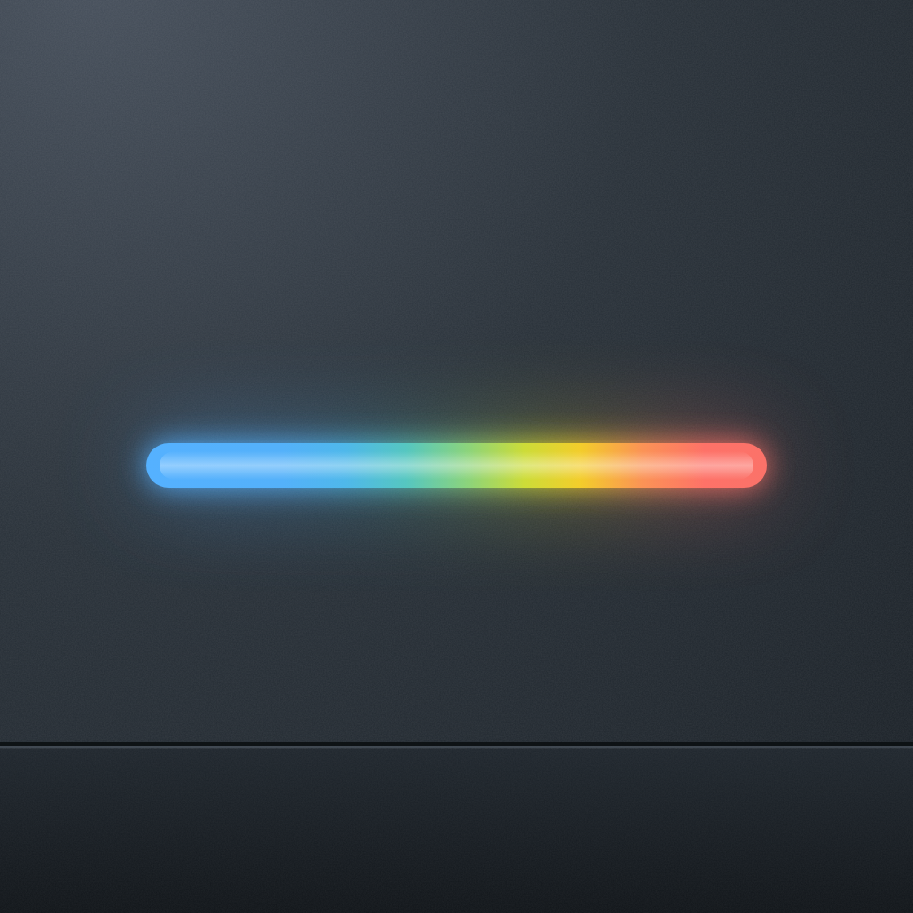
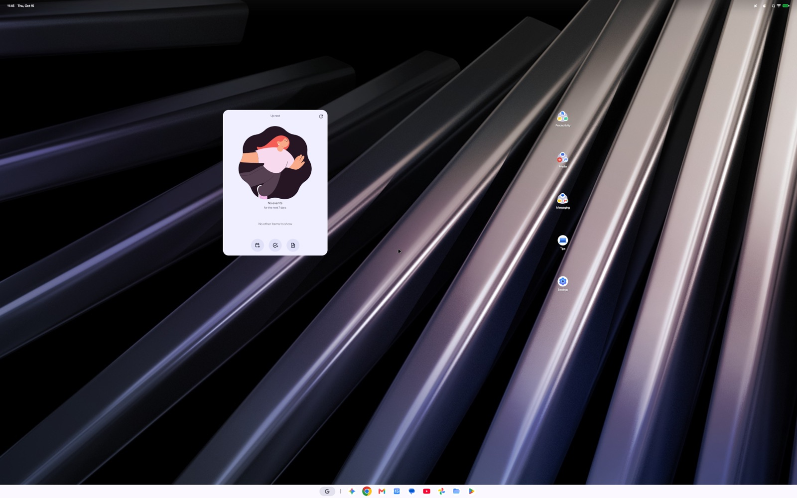
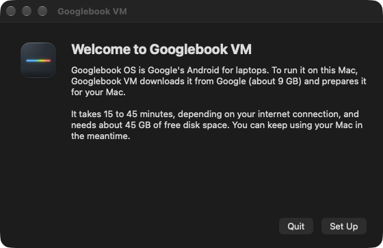
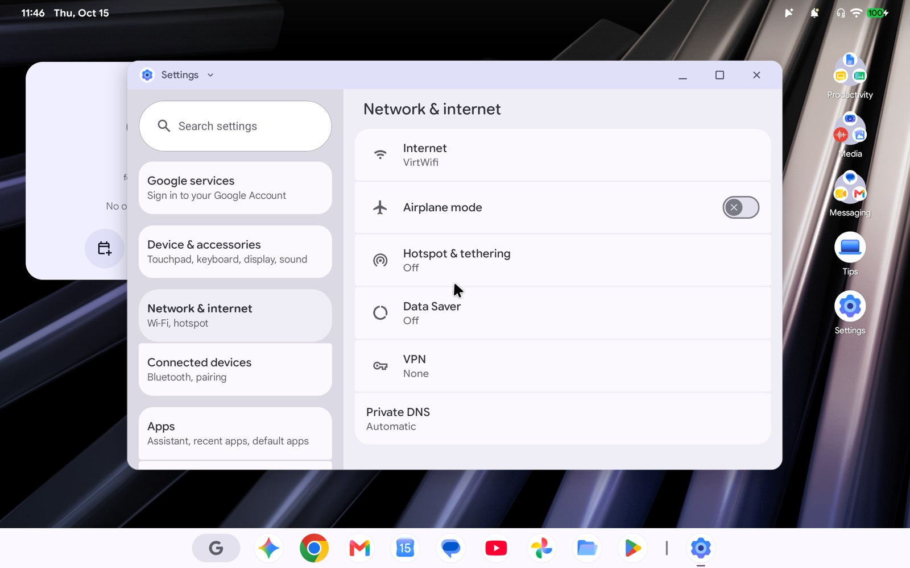

<p align="center"></p>

<h1 align="center">Googlebook VM</h1>

<p align="center"><b>Google's new laptop OS, running on your Mac.</b><br>
The real Googlebook OS, straight from Google, accelerated by your Mac's GPU. Free and open source.</p>

<p align="center">
  <a href="https://github.com/Rarasinhoo/gbos-vm/releases/latest/download/Googlebook-VM.dmg"><b>⬇&nbsp;&nbsp;Download for Mac</b></a>
  &nbsp;·&nbsp; Apple silicon (M1 or newer) &nbsp;·&nbsp; macOS 26 or newer
</p>



Googlebook OS is Android 17 made for laptops: a desktop with windows, a taskbar, Chrome and Google's apps. Googlebook VM downloads Google's own image for the Dell Googlebook and runs it on your Mac like an app. It isn't an emulator image or a lookalike.

- **Fast.** Android draws with your Mac's GPU, through Metal, at up to 120 Hz and your screen's full resolution.
- **Feels native.** Your Mac cursor just works. Your trackpad does two-finger scrolling, pinch to zoom, and three-finger swipes and taps, the Android way. Copy and paste go both ways, and Android types with your Mac's keyboard layout, accents included.
- **Everything plugged in.** Android uses your Mac's camera, microphone and speakers, sees its battery, and is online through your Mac. It can also join your Wi-Fi network as its own device.
- **Easy.** Download, open, click Set Up. No Terminal.

> Googlebook VM isn't made by or affiliated with Google or Dell, and it isn't a verified Googlebook. Read [Is it safe?](#is-it-safe) before you sign in to anything.

## Get it

You need a Mac with **Apple silicon** (M1 or newer) running **macOS 26 or newer**, **16 GB of memory**, and about **45 GB of free disk space**.

1. **[Download Googlebook VM](https://github.com/Rarasinhoo/gbos-vm/releases/latest/download/Googlebook-VM.dmg)** and open it. Drag **Googlebook VM** into **Applications**.
2. **Open it from Applications.** The first time, macOS says it can't check the app for malware, because it isn't signed with a paid Apple developer account. Click **Done**, then open **System Settings → Privacy & Security**, scroll down, and click **Open Anyway** next to *"Googlebook VM" was blocked*. Enter your password and click **Open Anyway** again. You only do this once.
3. **Click Set Up.** Googlebook VM downloads Googlebook OS from Google (about 9 GB) and prepares it for your Mac. That takes 15 to 45 minutes, depending on your internet connection, and you can keep using your Mac meanwhile. If it stops halfway, **Try Again** picks up where it left off.

<p align="center"></p>

Then Android starts, in about 45 seconds. Next time, it opens straight into Android. Drag the app to your Dock if you like.

## Using it



Move your pointer into the window and you're using Android. Move it out and you're back on your Mac.

| Shortcut | What it does |
|---|---|
| `⌃⌘F` | Full screen |
| `⌃⌘S` | Save a screenshot of Android to your Desktop |
| `⌘V` | Paste what you copied on the Mac |
| `⌃⌘R` | Restart Android |
| `⌃⌥` | Get your mouse back from a game that locked it |
| `⌘,` | Settings |
| `⌘Q` | Shut Android down and quit |

**Trackpad.** One finger moves the pointer, as on your Mac. Two fingers scroll (and a two-finger click is a right-click), pinch zooms, and three fingers swipe and tap the way they do on a Googlebook. If your Mac uses three- or four-finger swipes for Mission Control, turn on **Trackpad** in Settings to give them to Android while your pointer is over it.

**Settings** (`⌘,`) has the screen resolution, how much memory and how many processor cores Android gets, the network, and Android's storage. Android starts with 16 GB of storage, which Google's apps fill quickly; **Change…** gives it up to 1 TB. Android has to start over empty when you do that, like after a factory reset, and the app offers it when storage runs low. Your Mac only uses the space Android actually fills.

**Network.** Android is online through your Mac. Choose **On this Mac's network** in Settings, and Android joins your Wi-Fi as its own device, so your phone can find it. The app asks for your password once to set that up.

## Questions

<a name="is-it-safe"></a>
**Is it safe?** The app downloads Googlebook OS directly from Google and checks that every byte matches the official release. Nothing from Google is redistributed here. But to run on a Mac, part of the system is rebuilt with virtual-device pieces from Google's own Cuttlefish project. That means no hardware-protected keys and no verified boot for that part, and your data and its keys sit in one file on your Mac. Treat it like a test device: great for trying Googlebook OS, not for your bank. [What exactly changes](#what-we-change).

**Do Google's apps work?** Chrome, Gmail, YouTube, Gemini and the rest come with the system. Apps that insist on a certified device (some banking and streaming apps) may refuse to run.

**Why does macOS warn me when I first open it?** Apple asks developers $99 a year to sign apps. Googlebook VM isn't signed that way yet, so macOS can't vouch for it. The source code is all here, and you can [build it yourself](#build-it-yourself).

**Is it legal?** Googlebook VM is open source (MIT). It doesn't include Googlebook OS or any part of it: your Mac downloads Googlebook OS from Google's public servers, the same image anyone can download to restore a Googlebook.

**Intel Mac?** No. This runs Android's ARM code directly on Apple silicon through macOS's hypervisor, which an Intel Mac can't do.

**Where are my files, and how do I uninstall it?** Everything lives in `~/Library/Application Support/Googlebook VM`. To uninstall, quit the app, delete it from Applications, and delete that folder. If you used *On this Mac's network*, also run `sudo bash "/Applications/Googlebook VM.app/Contents/Resources/lan-setup.sh" --remove` in Terminal first.

**Updates?** Download the new version and replace the app. It updates Android's system on first start and keeps your apps and files.

**Something went wrong.** Please [open an issue](https://github.com/Rarasinhoo/gbos-vm/issues) and say what you saw. The setup log is `~/Library/Application Support/Googlebook VM/logs/setup.log`.

## What doesn't work yet

- **Bluetooth.** macOS doesn't let a VM use the Mac's Bluetooth. A USB Bluetooth adapter passed to Android is the plan, for Quick Share, Better Together and headphones.
- **Some web graphics** can shade slightly wrong (flat-shaded WebGL), because of a small gap between Android's graphics and Metal.
- **Moving the window to another screen** keeps the old refresh rate until the next restart.
- It's built and tested on an M5 Mac, and people report it working on M4 Macs. If you try another one, [tell us](https://github.com/Rarasinhoo/gbos-vm/issues) how it went.

## Build it yourself

You need the Xcode command line tools and [Homebrew](https://brew.sh); the script offers to install everything else (the Android SDK pieces, Rust, CMake, Bazel, a JDK, Python 3.10+), and never uses `sudo`.

```bash
git clone https://github.com/Rarasinhoo/gbos-vm.git
cd gbos-vm
./install.sh
```

Then open `work/host/Googlebook VM.app`. It downloads about 9 GB, wants 60 GB free, and the build takes around five minutes on an M5. After a `git pull`, quit the VM and run `./update-image.sh`: it rebuilds what changed and refreshes the system part of the disk, keeping your data.

`./package-app.sh` turns a finished build into the downloadable app (`work/dist/Googlebook-VM.dmg`); `--release` also gathers the source of every library it bundles.

<details>
<summary><b>Everything a developer might want to know</b></summary>

Everything lands in `work/` (set `GOOGLEBOOK_WORK` to put it elsewhere). If you already have the big downloads, point `GOOGLEBOOK_DOWNLOADS` at them and they won't be fetched again. Builds use four jobs by default; raise `GBOS_JOBS` if you have the RAM, but an uncapped Mesa build will happily push a 16 GB Mac into swap. `./prereqs.sh` on its own shows what's installed. To start the VM from a terminal, `python3 run/launch.py work` opens the app and waits for it to quit; `--display 1920x1200` and `--fullscreen` set those options first.

```
install.sh          runs the five steps below in order
fetch.sh            downloads + verifies the Googlebook image, Cuttlefish, and UTM
build-host.sh       QEMU launcher, viewer app
build-guest.sh      pointer helper, Vulkan self-test, SELinux policy tool
build-gfxstream.sh  gfxstream renderer, QEMU with its device, the guest's Vulkan driver
build-image.sh      assembles the bootable disk
update-image.sh     refreshes an existing disk after a git pull, keeping your data
package-app.sh      the downloadable app and its DMG
run/                VM runner, setup, storage and network tools (the app bundles these)
image/              the scripts that rebuild the vendor partition
guest/  host/       sources for the bits we wrote
patches/            our changes to gfxstream, QEMU, Mesa and CocoaSpice
tests/              storage, pointer, soak and display smoothness tests
```

**What gets downloaded, and from where.** Each is checked against a pinned SHA-256: the Googlebook recovery image from `dl.google.com` (build `16471258`), the Cuttlefish virtual-device image from `ci.android.com` (build `16373615`), UTM 5.0.6 beta from its GitHub release (for MoltenVK, ANGLE and SPICE), and, for building from source, UTM's QEMU 10.0.12, gfxstream (the macOS fork from google/gfxstream#168), rutabaga_gfx, Android's Mesa and libsepol 3.11. The downloadable app carries what we build, plus the open-source libraries it needs, listed with their licences in the app's `THIRD_PARTY.md`; each release publishes their sources.

**Diagnostics.** Each run keeps a log folder in `logs/<run>/`, with the guest console in `serial.log`. `run/vm_control.py RUN_DIR VERB` asks the guest for a report: `VM_STATUS`, `VM_LOG`, `VM_TOP`, `VM_SF` (frame pacing), `VM_DISK` (storage), `VM_KEYBOARD`, `VM_WIFILOG`. `notifyutil -p local.googlebook.screenshot` saves a screenshot into the run's folder.

</details>

## How it works

<a name="what-we-change"></a>
<details>
<summary><b>What we change in Googlebook OS</b></summary>

The image starts as Google's unmodified recovery download. We don't touch the system partitions. But Googlebook OS expects hardware our VM doesn't have (a TPM, Trusty, a Qualcomm DSP, a specific GPU), so the **vendor partition gets rebuilt** with virtual-device replacements from Google's own Cuttlefish project:

- **Software KeyMint and Gatekeeper** instead of hardware-backed ones. Your keys aren't protected by a secure element, because there isn't one.
- **No verified boot on the vendor partition.** The other partitions keep their original verity; the one we modify can't.
- **A few narrow SELinux rules**: graphics buffer sharing for the apps that draw, and what the virtual Wi-Fi needs. SELinux stays enforcing.
- **No lock screen, unlocked boot state.** Setup is skipped and the screen stays on. Keys are software only and sit on the same disk as your data, so keep the disk file private (it's readable only by you).
- **A guest log.** Each run's `serial.log` holds guest console output, including crash excerpts and package names. Nothing prunes old runs.
- **Cuttlefish's Bluetooth service** instead of the Qualcomm one, so the missing Qualcomm radio doesn't crash on boot. With no radio attached, Android is told it has no Bluetooth.
- **Virtual Wi-Fi.** The VM's network card appears as a Wi-Fi network (`virt_wifi`), with Cuttlefish's generic Wi-Fi service, so Android's apps see a normal Wi-Fi connection.
- **A helper running as the Android shell user** that takes pointer, trackpad, keyboard-layout and clipboard input from the app. It listens to nothing and connects out to your Mac; both ends prove a random per-boot token to each other before anything else is sent.
- **AOSP's V4L2 camera provider** (Cuttlefish's build) instead of Googlebook's USB camera HAL, plus one service label for it. The device declares an external camera instead of a front one, because that's what the provider reports.
- **Cuttlefish's audio configuration, edited for a USB microphone:** an input-only USB audio module is added, and the built-in microphone the VM doesn't have is removed.
- **Frame timing for 120 Hz.** SurfaceFlinger starts each frame within one refresh, instead of the laptop panel's 60 Hz budget.

</details>

<details>
<summary><b>The graphics</b></summary>

**A guest driver that matches the Mac's renderer.** gfxstream's Mac support lives in a fork of Google's renderer, cut from one revision of Android's Mesa; the guest's Vulkan driver has to speak exactly that revision's protocol, or Android's compositor crashes on its first frame. So `build-gfxstream.sh` builds the guest driver from that same Mesa revision, outside the Android source tree, with small stand-ins for the few Android headers it wants (`guest/gfxstream-shims`, `patches/mesa-gfxstream-guest.patch`).

**Frames without a copy.** gfxstream draws into Metal textures, and QEMU's SPICE display already knows how to blit a Metal texture into the IOSurface the viewer shows. The renderer now hands QEMU the texture behind each scanout, and a small compute shader converts its RGBA to the viewer's BGRA on the GPU (`patches/gfxstream-host.patch`, `patches/qemu-gfxstream.patch`). That roughly doubled the frame rate over reading every frame back.

**Android's assumptions about a GPU.** Android's UI renderer insists on two graphics queues (MoltenVK has one; gfxstream offers a virtual second). The Linux kernel hands a graphics context id to the next process the moment the last one lets go, while the renderer was still cleaning up after the old owner under that id, destroying the new process's objects; the renderer now finishes first. And ANGLE offers OpenGL ES 3, which Chrome needs, only with `VK_EXT_provoking_vertex`, which UTM's MoltenVK leaves out, so the guest driver offers it itself.

**Video in the right colours.** Android's software decoders hand the compositor YV12 frames. Those buffers are marked for CPU access, so the renderer made them linear, while the guest reads them through optimally tiled images bound to the same memory; on MoltenVK the two don't lay planes out alike. YUV buffers are now always optimal and kept in the NV12 shape on both sides, converted on the way in and out.

**The refresh rate follows your screen**, up to 120 Hz, as a whole fraction of it where needed so every frame stays up the same number of refreshes (144 Hz gets 72). QEMU hard-codes 75 Hz in the display description it gives the guest, so the runner patches that one constant in a copy of QEMU's library. **Frames are shown on the guest's clock**, not as they arrive: the viewer rebuilds the guest's frame timing and shows every frame the same few milliseconds after it was due, so jitter in the copy from the guest doesn't make frames stay up a refresh too long or too short. `tests/perf.py` measures it.

</details>

<details>
<summary><b>The pointer and the trackpad</b></summary>

Android wouldn't accept QEMU's absolute tablet, and a relative mouse drifts from your real cursor. Injecting events at the exact position (the way scrcpy does) works, but Android counts every injected event as one virtual device and gives cursor shapes only to real mice. So the helper creates a real virtual mouse and steers it: once into the corner, where Android stops it, then by exact pixel deltas, and it checks where Android says the pointer is whenever it rests. That's why Android's pointer takes the shapes apps ask for (an I-beam over text, a hand over links). Over the window the Mac cursor hides and Android's takes its place; over any macOS window or prompt, the Mac's comes back.

When an Android app asks to lock the pointer (a game, or a web page using pointer lock), the Mac mouse locks for it and raw motion goes through the same virtual mouse. When the app lets go, so does the Mac; `⌃⌥` gets your mouse back early. The lock only happens while the window is in front with the cursor over it.

On a Mac trackpad, two fingers or more go to a virtual multitouch touchpad in Android: the viewer passes your finger positions, and Android does scrolling with its own momentum, pinch, and three-finger gestures. Two fingers reach Android once they move, so a two-finger tap stays your Mac's right click. With **Trackpad** on in Settings, an event tap holds back the Dock's own swipe events while the pointer is over Android (it needs the Accessibility permission).

</details>

<details>
<summary><b>Camera, microphone, keyboard, battery, storage</b></summary>

**A webcam that is really a process.** QEMU on macOS has no virtual camera, and the Mac's camera isn't a USB device it could pass through. But QEMU's `usb-redir` lets something outside the VM *be* a USB device, so the viewer speaks that protocol over a socket and presents a standard UVC webcam (MJPEG over a bulk endpoint) fed by AVFoundation (`host/webcam.m`). The guest kernel already has `uvcvideo`; the image swaps Googlebook's GPU-heavy camera HAL for AOSP's plain V4L2 provider (`image/mica_camera_port.py`). The microphone is the same trick (`host/microphone.m`): a USB Audio Class microphone streaming one isochronous packet per millisecond from AVAudioEngine, with Android's audio setup edited to use it (`image/mica_audio_port.py`). The camera and microphone only run while an Android app uses them, and macOS asks you first.

**Keyboard.** The viewer sends your Mac's input source to the helper, which sets the closest of Android's own layouts on the VM's keyboard: Brazilian Pro or U.S. International get *English (US), International*, with the same dead keys, and so on for the common layouts. Ideas from [dragonro/googlebookos-vm](https://github.com/dragonro/googlebookos-vm).

**Battery.** Android shows your Mac's battery level and charging state.

**Storage.** Android encrypts its storage, so it can't grow in place. Changing its size (`run/storage.py`) gives it a fresh, empty partition and resets the encryption keys' partition to the recovery image's, as a factory reset does. The disk file is sparse, so your Mac stores only what Android writes. `tests/storage.py` checks it on a small made-up disk.

**Signing.** A build from source signs the app with a certificate made for your work folder (in a keychain file of its own, not your login keychain), so macOS remembers the permissions you give it across rebuilds.

</details>

<details>
<summary><b>Bluetooth through the Mac (experimental)</b></summary>

macOS doesn't hand a VM its Bluetooth radio, so `run/run_vm.py --bluetooth` gives Android a virtual one (the Android Emulator's `netsimd`) and the viewer fills it with twins. For each Bluetooth LE accessory CoreBluetooth sees, the viewer opens one more controller on the simulated radio and acts there as that device: it advertises what the Mac heard, accepts Android's connection, and answers GATT from the real device through CoreBluetooth (`host/bluetooth.m`, a small BLE peripheral stack). It works for LE accessories; phones (Quick Share, Better Together) don't work through it, so it isn't in Settings.

</details>

## Credits

Googlebook VM started as [skylartaylor/gbos-vm](https://github.com/skylartaylor/gbos-vm), and leans entirely on other people's work: [UTM](https://github.com/utmapp/UTM) and its forks of QEMU and CocoaSpice, Google's [gfxstream](https://android.googlesource.com/platform/hardware/google/gfxstream) and [rutabaga_gfx](https://github.com/magma-gpu/rutabaga_gfx), [Mesa](https://mesa3d.org), [MoltenVK](https://github.com/KhronosGroup/MoltenVK), QEMU, [socket_vmnet](https://github.com/lima-vm/socket_vmnet), and the Android Cuttlefish team, whose virtual-device components are what make the image boot at all. The pointer helper uses the same trick as [scrcpy](https://github.com/Genymobile/scrcpy). The app icon is by [thangman22](https://github.com/thangman22/gbos-vm).

## License

MIT for everything we wrote; see [LICENSE](LICENSE). The patches apply to MIT-licensed projects, except `patches/cocoaspice-viewer.patch`, which modifies Apache-2.0 code and stays under that licence. The downloadable app bundles open-source libraries under their own licences, listed in its `THIRD_PARTY.md`.

## AI usage

These AI tools helped build this project:
- OpenAI GPT 6 Astra
- DeepSeek 4.1 Flash
- Anthropic Claude Opus 5.5
